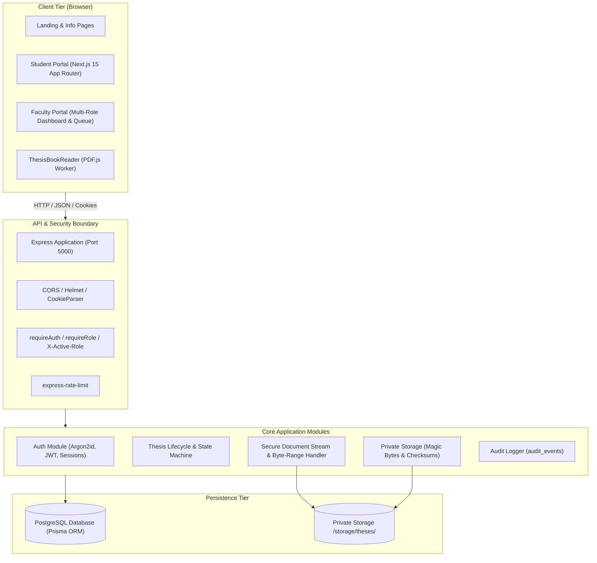
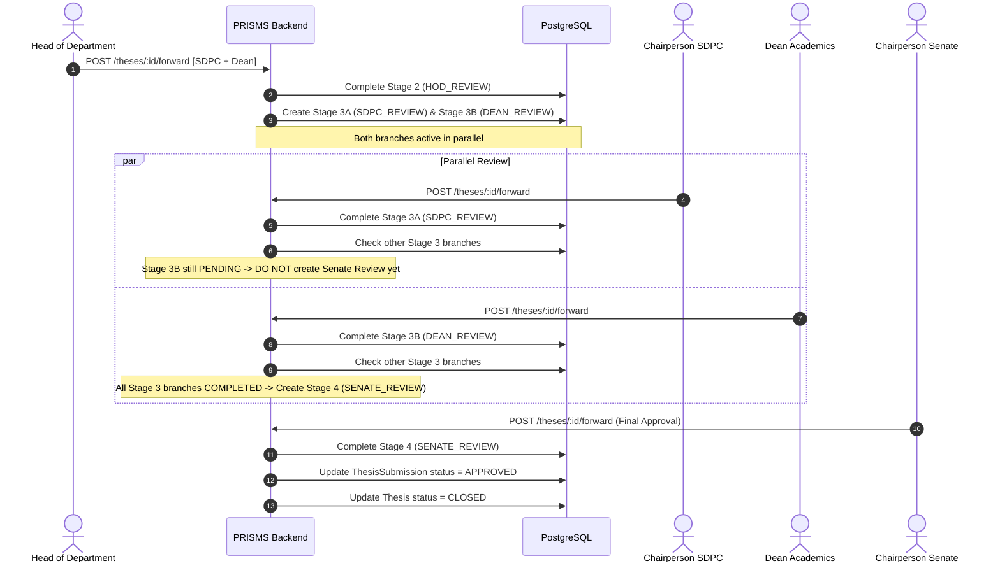

# PRISMS System Architecture

This document describes the high-level architecture, module decomposition, security boundary, and data flow of the **PhD Research & Institutional Scholars Management System (PRISMS)** for NIT Hamirpur.

---

## 1. High-Level Architecture Overview

PRISMS is structured as a decoupled full-stack architecture comprising an Express TypeScript backend API, a Next.js 15 frontend application, and a PostgreSQL relational database managed via Prisma ORM.

---

## 2. Frontend Architecture (Next.js 15 App Router)

The frontend is built on **Next.js 15.2.1** utilizing React 19, TypeScript 5.8, and Tailwind CSS 3.4.

### 2.1 Route Decomposition
The application comprises 28 statically optimized and dynamic routes:
- **Public & Marketing:** `/`, `/about`, `/contact`, `/guidelines`, `/workflow`, `/login`
- **Student Portal:**
  - `/student/dashboard`: Current academic status, active thesis version, progress tracker
  - `/student/thesis/submit`: Multi-step submission wizard with pre-validation and PDF upload
  - `/student/thesis/details`: Comprehensive thesis record, review timeline, and remarks
  - `/student/thesis/history`: Immutable archive of all submission versions
  - `/student/thesis/reader`: Embedded in-portal PDF reader
- **Faculty Portal:**
  - `/faculty/dashboard`: Overview of tasks, scholars, and quick links
  - `/faculty/queue`: Institutional review tasks filtered by assigned role
  - `/faculty/reviews/[id]`: Review workspace for Supervisor, DDPC, SDPC, Dean, Senate
  - `/faculty/reviews/[id]/hod`: Dedicated HOD evaluation workspace with parallel forwarding
  - `/faculty/thesis/reader/[id]`: Secure inline dissertation reader
  - `/faculty/scholars`: Supervised scholar roster with search and pagination
  - `/faculty/scholars/[id]`: Historical scholar dossier and submission versions

### 2.2 Reusable Components & ApplicationShell
All portal pages inherit from [`ApplicationShell`](file:///home/ankurgupta/PRISMS/frontend/src/components/ApplicationShell.tsx), providing:
- Institutional bilingual header (English / Hindi) with official NITH crest.
- Role context indicator and switcher for multi-role faculty.
- Navigation links adapted to active role (Student vs. Faculty).
- Clean institutional footer adhering to the approved reference layout.

### 2.3 Secure In-Portal Document Reader ([`ThesisBookReader`](file:///home/ankurgupta/PRISMS/frontend/src/components/ThesisBookReader.tsx))
- Integrated with local PDF.js worker (`/pdf.worker.min.mjs`) to avoid CDN dependencies.
- Handles concurrent page render cancellation to prevent canvas collision errors.
- Communicates with `/theses/:id/file/view` using HTTP `Range: bytes=start-end` requests for fast, progressive loading of large dissertations (e.g. 600+ pages).
- Enforces statutory download restrictions directly in the UI based on server-provided permissions (`canDownload = false`).

---

## 3. Backend Architecture (Express & TypeScript)

The backend is built with **Node.js (v22+)**, **Express 5**, and **TypeScript** configured with NodeNext ESM module resolution.

### 3.1 Core Modules
- **`modules/auth`:** User registration, email verification, session rotation, password reset, and JWT cookie management.
- **`modules/thesis`:** Thesis drafting, PDF upload integrity checks, multi-stage workflow engine, parallel review branching, document streaming, and scholar tracking.
- **`lib/storage.ts`:** Private filesystem storage outside the web root. Validates `%PDF-` file signatures, enforces maximum file sizes, and provides range-capable read streams.
- **`lib/audit.ts`:** Structured audit event recording for compliance.
- **`middleware/`:** Authentication, role enforcement, active role verification, input validation (Zod), and centralized error handling.

---

## 4. Security Architecture & Statutory Constraints

### 4.1 Authentication & Multi-Role Authorization
- **Credentials:** Passwords hashed with Argon2id.
- **Session Tokens:** Short-lived JWT access tokens stored in HTTP-only, `SameSite=Lax` cookies (with bearer fallback for API clients).
- **Session Revocation:** Refresh tokens stored as SHA-256 hashes in `sessions` table, enabling instantaneous single-session or all-session revocation (`/auth/logout-all`).
- **Role Context Enforcement:** Faculty holding multiple positions (e.g. Supervisor and HOD) can provide `X-Active-Role` or `?role=`. The server cryptographically validates that the user actually holds the claimed role, rejecting spoofed contexts with `403 ROLE_UNAUTHORIZED`.

### 4.2 Mandatory Statutory HOD Download Restriction
In strict compliance with NIT Hamirpur doctoral ordinances:
- **Head of Department (HOD) access is confined exclusively to in-portal inline viewing.**
- At no point during the HOD evaluation stage may a thesis file be downloaded, saved locally, or exported.
- The backend enforces this strictly at `/theses/:submissionId/file/download`:
  - When the user's active role is `HOD`, the server immediately responds with **`403 Forbidden` (`DOWNLOAD_FORBIDDEN_FOR_ROLE`)**.
  - All download attempts are logged to `audit_events`.
- In the frontend, download controls are replaced with an explicit statutory view-only notice.

### 4.3 Secure PDF Streaming & Storage Isolation
- Thesis files are never saved in public or static directories. They are stored in `backend/storage/theses/` using UUID-based filenames (`<storageKey>.pdf`).
- Inline viewing via `/theses/:id/file/view` streams data directly from disk to the client with:
  - `Content-Type: application/pdf`
  - `Content-Disposition: inline; filename="..."`
  - `Cache-Control: private, no-store, must-revalidate`
  - `Accept-Ranges: bytes` (supporting HTTP 206 Partial Content)
- Range requests enable browsers and PDF.js to stream specific byte segments without holding massive multi-megabyte PDFs in server memory.

---

## 5. Parallel Review Convergence Architecture

When a submission is evaluated by the Head of Department (Stage 2), the HOD may forward the submission to:
1. **Chairperson SDPC** (Single branch)
2. **Dean Academics** (Single branch)
3. **Both SDPC and Dean in Parallel**

If either parallel reviewer returns the thesis for revision or rejects it, all parallel branches are cancelled, and the thesis transitions immediately to `REVISION_REQUIRED` or `REJECTED`.
