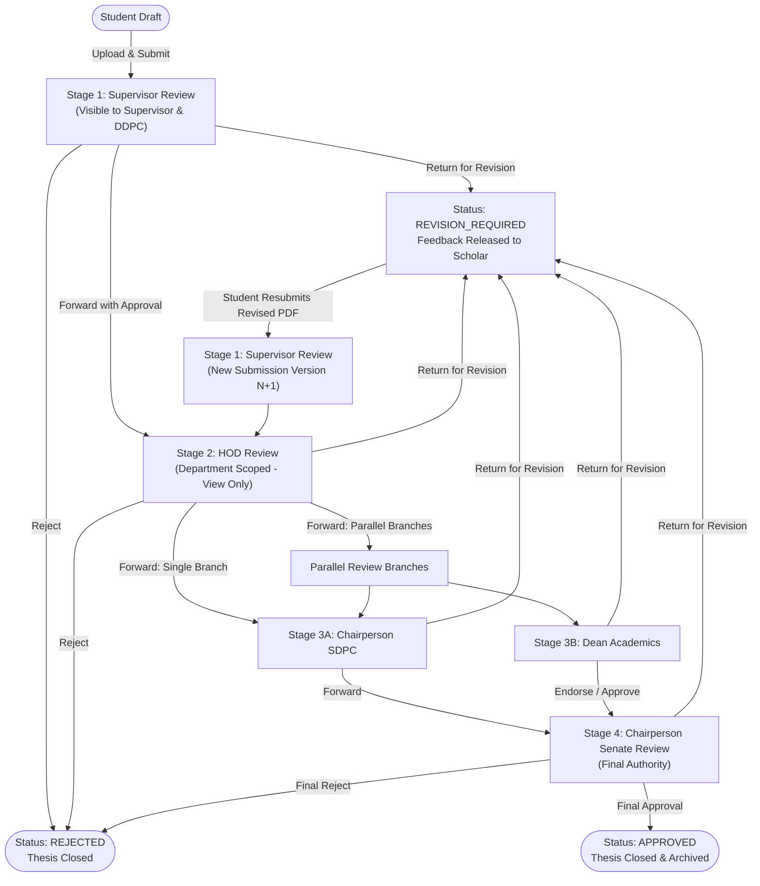

# PRISMS Thesis Workflow Specification

This document details the complete academic lifecycle of doctoral thesis submissions at NIT Hamirpur, from student drafting through supervisory review, departmental evaluation, parallel institutional review, revision loops, and final approval by the Chairperson Senate.

---

## 1. Architectural Principles

1. **Database as Single Source of Truth:** Workflow stages, assignments, and status transitions are governed entirely by database records and server-side state machine rules. The client cannot dictate transitions.
2. **Immutable Versioning:** Resubmitting after revision creates a new version (`submissionNumber` 2, 3, ...). Previous versions, uploaded files, and reviewer remarks remain permanently preserved.
3. **Transactional Safety:** Multi-table transitions (assignment completion, stage closure, next stage creation, status update) are executed inside atomic PostgreSQL transactions (`prisma.$transaction`).
4. **Dynamic Authority Routing:** Recipient lists are dynamically derived from verified database relationships (scholar's department and supervisor mappings) rather than client input.

---

## 2. Workflow Stage Sequence

| Sequence | Stage Code | Responsible Role | Recipient Selection | Allowed Actions |
|:---:|:---|:---|:---|:---|
| **0** | `DRAFT` | `STUDENT` | N/A | Save draft, Upload PDF, Submit |
| **1** | `SUPERVISOR_REVIEW` | `SUPERVISOR` | HOD (scholar's dept) | Forward to HOD, Return for revision, Reject |
| **2** | `HOD_REVIEW` | `HOD` | SDPC, Dean Academics, or Both | Forward to SDPC/Dean, Return, Reject *(No Download)* |
| **3A** | `SDPC_REVIEW` | `CHAIRPERSON_SDPC` | Chairperson Senate | Forward to Senate, Return, Reject |
| **3B** | `DEAN_REVIEW` | `DEAN_ACADEMICS` | Parallel branch / Observer | Approve/Forward, Return, Reject |
| **4** | `SENATE_REVIEW` | `CHAIRPERSON_SENATE` | Final Authority | Final Approval (`APPROVED`), Return, Final Reject |

---

## 3. Workflow State Transition Diagram

---

## 4. Stage-by-Stage Lifecycle Walkthrough

### Stage A: Student Submission & Initial Routing
1. **Drafting:** The student creates and updates research metadata (`workingTitle`, `abstract`, `researchArea`) in their `theses` record.
2. **Upload:** Student uploads the thesis PDF. The server validates:
   - Size limit (default 20 MiB via `MAX_THESIS_FILE_SIZE_BYTES`).
   - Magic bytes signature (`%PDF-`).
   - Computes SHA-256 checksum and saves to private storage (`storageKey = UUID.pdf`).
3. **Formal Submission:** When the student clicks submit:
   - Verifies an active supervisor is mapped in `student_supervisor_assignments`.
   - Prevents duplicate initial submissions if one is already active (`SUBMITTED` or `IN_REVIEW`).
   - Creates a new `ThesisSubmission` row (`submissionNumber = 1`, `status = SUBMITTED`).
   - Creates `SubmissionStage` for `SUPERVISOR_REVIEW`.
   - Creates `ReviewAssignment` for the assigned supervisor.
   - Grants DDPC observer view access for departmental submissions.

### Stage B: Supervisor Review
- **Visibility:** Visible in the supervisor's active queue and the scholar's tracking list.
- **Actions:**
  - **Inline Viewing:** Document is streamed inline with restricted cache headers.
  - **Download:** Permitted for the assigned supervisor.
  - **Return for Revision:** Requires non-empty remarks. Marks status as `REVISION_REQUIRED`. Student is prompted to revise.
  - **Reject:** Sets status to `REJECTED`, thesis is `CLOSED`.
  - **Forward to HOD:** The supervisor requests `/theses/:id/recipients`. The backend dynamically returns only active HODs from the scholar's department. Supervisor approves and forwards. Stage advances to `HOD_REVIEW`.

### Stage C: HOD Review
- **Mandatory Policy Rule:** **HOD is strictly prohibited from downloading the thesis document.** The view endpoint provides full read capabilities for review, while the download endpoint returns `403 Forbidden` (`DOWNLOAD_FORBIDDEN_FOR_ROLE`).
- **Recipient Selection:**
  - HOD can choose:
    1. **Chairperson SDPC**
    2. **Dean Academics**
    3. **Both (Parallel Review)**
- **Parallel Branches:**
  - If both are selected, two `SubmissionStage` records are activated in parallel.
  - Neither branch can prematurely finalize the thesis alone.
  - If either branch requests return or rejection, pending assignments are closed and the workflow halts for student revision.

### Stage D: Chairperson SDPC & Dean Academics
- Reviewers inspect the submission and document in the portal.
- Review remarks are recorded.
- When SDPC approves, they select an active Chairperson Senate from the institutional recipient list.

### Stage E: Chairperson Senate (Final Authority)
- Chairperson Senate conducts final institute-level review.
- Final approval sets `ThesisSubmission.status = APPROVED` and `Thesis.status = CLOSED`.
- Audit logs record final approval and completion.

---

## 5. Resubmission and Version Preservation

When a thesis is returned with `REVISION_REQUIRED`:
1. The student reads the released feedback from reviewers.
2. The student uploads a new revised PDF document.
3. The student calls `POST /theses/resubmit`.
4. A new `ThesisSubmission` is generated with `submissionNumber = N + 1` (e.g. Version 2).
5. All previous versions (files, timestamps, stages, reviewer decisions) are preserved intact.
6. The workflow restarts at Stage 1 (Supervisor Review).

---

## 6. Audit Trail Integration

Every critical lifecycle transition triggers an immutable audit log entry in `audit_events`:
- `thesis.draft_saved`
- `thesis.submitted`
- `thesis.resubmitted`
- `thesis.forwarded`
- `thesis.returned_for_revision`
- `thesis.rejected`
- `thesis.final_approved`
- `thesis.file_viewed`
- `thesis.file_downloaded`
- `thesis.file_download` (`DENIED` when attempted by HOD)
